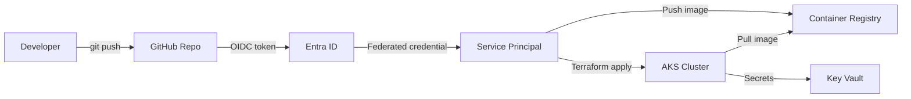

## Architecture



## What I Built

This lab provisions an AKS cluster entirely through Terraform and deploys applications using GitHub Actions with workload identity federation (OIDC). No client secrets, no stored credentials — the trust is established between GitHub and Entra ID at the identity level.

### Step 1: Terraform Foundation

The Terraform configuration provisions the core infrastructure: a resource group, AKS cluster with system-assigned managed identity, ACR for container images, and Key Vault for application secrets.

```hcl
resource "azurerm_kubernetes_cluster" "main" {
  name                = "aks-${var.environment}-${var.project}"
  location            = azurerm_resource_group.main.location
  resource_group_name = azurerm_resource_group.main.name
  dns_prefix          = "aks-${var.project}"
  kubernetes_version  = "1.28"

  default_node_pool {
    name       = "system"
    node_count = 2
    vm_size    = "Standard_B2s"

    upgrade_settings {
      max_surge = "10%"
    }
  }

  identity {
    type = "SystemAssigned"
  }

  oidc_issuer_enabled       = true
  workload_identity_enabled = true

  network_profile {
    network_plugin = "azure"
    network_policy = "calico"
  }
}
```

### Step 2: GitHub OIDC Federation

The federated credential allows GitHub Actions to authenticate to Azure without secrets. The trust chain is: GitHub issues a short-lived OIDC token → Entra ID validates the token against the configured subject claim → Azure grants a temporary access token.

```hcl
resource "azurerm_federated_identity_credential" "github" {
  name                = "github-actions-oidc"
  resource_group_name = azurerm_resource_group.main.name
  parent_id           = azurerm_user_assigned_identity.github_deployer.id
  audience            = ["api://AzureADTokenExchange"]
  issuer              = "https://token.actions.githubusercontent.com"
  subject             = "repo:Tusartus/aks-terraform-github-oidc:ref:refs/heads/main"
}
```

### Step 3: GitHub Actions Workflow

The deployment workflow uses `azure/login` with OIDC. No `AZURE_CREDENTIALS` secret needed.

```yaml
name: Deploy to AKS
on:
  push:
    branches: [main]

permissions:
  id-token: write
  contents: read

jobs:
  deploy:
    runs-on: ubuntu-latest
    steps:
      - uses: actions/checkout@v4

      - name: Azure Login (OIDC)
        uses: azure/login@v2
        with:
          client-id: ${{ secrets.AZURE_CLIENT_ID }}
          tenant-id: ${{ secrets.AZURE_TENANT_ID }}
          subscription-id: ${{ secrets.AZURE_SUBSCRIPTION_ID }}

      - name: Get AKS credentials
        run: az aks get-credentials --resource-group $RG --name $CLUSTER

      - name: Deploy
        run: kubectl apply -f k8s/
```

## Key Decisions and Trade-offs

- **OIDC over service principal secrets**: More setup upfront but eliminates secret rotation and leak risk entirely.
- **Standard_B2s nodes**: Burstable VMs keep costs low for lab workloads. Not suitable for sustained production CPU.
- **Calico network policy**: Adds microsegmentation capability at the cost of slightly more complex networking.
- **System-assigned identity for AKS**: Simpler lifecycle management — identity is created and destroyed with the cluster.

## Security Considerations

- No long-lived credentials stored anywhere — GitHub, Key Vault, or pipeline variables.
- OIDC subject claim scoped to `main` branch only — PRs cannot trigger production deployments.
- Network policy enabled from day one — default-deny can be layered on top.
- Key Vault with RBAC authorization (no access policies) for fine-grained secret access.
- ACR pull integrated via AKS managed identity — no image pull secrets in manifests.

## Cost Notes

Estimated monthly cost: **~€12/month** for 2x Standard_B2s nodes in West Europe. ACR Basic tier adds ~€5/month. Key Vault operations are negligible at lab scale. Tear down with `terraform destroy` when not in use.

## How to Reproduce

```bash
# Clone the repo
git clone https://github.com/Tusartus/aks-terraform-github-oidc.git
cd aks-terraform-github-oidc

# Initialize Terraform
terraform init

# Plan and apply
terraform plan -out=tfplan
terraform apply tfplan

# Configure kubectl
az aks get-credentials --resource-group rg-lab-aks --name aks-lab-main

# Verify
kubectl get nodes
```

## Lessons Learned

1. **OIDC federation is the future of CI/CD auth** — once set up, you never think about secret rotation again.
2. **Terraform state management matters** — remote state in Azure Blob Storage with locking prevents team conflicts.
3. **AKS version pinning is critical** — auto-upgrade sounds convenient until your workloads break on a minor Kubernetes release.
4. **Start with network policy enabled** — retrofitting Calico onto a running cluster is painful.
