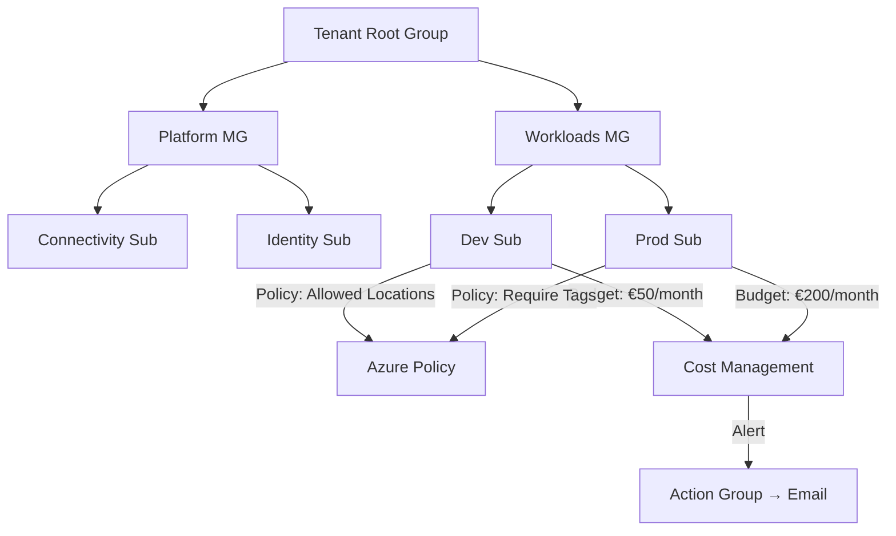

## Architecture



## What I Built

This lab sets up an Azure governance framework using management groups, Azure Policy, RBAC, and cost budgets. The goal: prevent rogue deployments, enforce tagging, restrict locations, and alert on budget thresholds — all through code.

### Step 1: Management Group Hierarchy

The hierarchy follows the Cloud Adoption Framework pattern: separate platform and workload subscriptions under logical management groups.

```hcl
resource "azurerm_management_group" "platform" {
  display_name               = "Platform"
  parent_management_group_id = data.azurerm_management_group.root.id
}

resource "azurerm_management_group" "workloads" {
  display_name               = "Workloads"
  parent_management_group_id = data.azurerm_management_group.root.id
}

resource "azurerm_management_group_subscription_association" "dev" {
  management_group_id = azurerm_management_group.workloads.id
  subscription_id     = "/subscriptions/${var.dev_subscription_id}"
}
```

### Step 2: Azure Policy Assignments

Policies enforce guardrails: allowed regions, required tags, and denied resource types.

```hcl
resource "azurerm_management_group_policy_assignment" "allowed_locations" {
  name                 = "allowed-locations"
  management_group_id  = azurerm_management_group.workloads.id
  policy_definition_id = "/providers/Microsoft.Authorization/policyDefinitions/e56962a6-4747-49cd-b67b-bf8b01975c4c"

  parameters = jsonencode({
    listOfAllowedLocations = {
      value = ["westeurope", "northeurope"]
    }
  })
}

resource "azurerm_management_group_policy_assignment" "require_env_tag" {
  name                 = "require-env-tag"
  management_group_id  = azurerm_management_group.workloads.id
  policy_definition_id = "/providers/Microsoft.Authorization/policyDefinitions/871b6d14-10aa-478d-b466-1e8b3f02c5e0"

  parameters = jsonencode({
    tagName = { value = "Environment" }
  })
}
```

### Step 3: Budget Alerts

```bash
# Create a budget with action group alert
az consumption budget create \
  --budget-name "dev-monthly" \
  --amount 50 \
  --time-grain Monthly \
  --start-date 2024-01-01 \
  --end-date 2025-12-31 \
  --category Cost \
  --resource-group rg-lab-governance

# Create action group for email alerts
az monitor action-group create \
  --name "budget-alerts" \
  --resource-group rg-lab-governance \
  --short-name "budget" \
  --email-receivers name=admin email=contact@avarthusdevcloud.cloud
```

## Key Decisions and Trade-offs

- **Management groups over subscription-level policy**: Scales better — policies propagate down the hierarchy.
- **Built-in policies over custom**: Less maintenance. Custom policies only when built-in doesn't cover the requirement.
- **Deny effect over Audit**: Stronger enforcement but can block legitimate deployments if too aggressive. Start with Audit, promote to Deny.
- **Budget alerts over hard spending limits**: Azure budgets are advisory only — they alert but don't stop spending. Acceptable for labs.

## Security Considerations

- RBAC follows least-privilege: Reader at management group level, Contributor only at subscription.
- Policy assignments use system-assigned managed identity for remediation tasks.
- Privileged roles (Owner, User Access Administrator) assigned only at specific scope, never at root.
- Audit logs enabled via Azure Activity Log forwarded to Log Analytics.

## Cost Notes

Estimated monthly cost: **~€0/month**. Azure Policy, RBAC, Management Groups, and Cost Management are free. Only the underlying resources incur costs.

## How to Reproduce

```bash
# Clone the repo
git clone https://github.com/Tusartus/azure-governance-policy-budgets.git
cd azure-governance-policy-budgets

# Deploy governance framework
cd infra && terraform init && terraform apply

# Verify policy assignments
az policy assignment list --scope /providers/Microsoft.Management/managementGroups/Workloads

# Test compliance
az policy state summarize --management-group Workloads
```

## Lessons Learned

1. **Start governance early** — retrofitting policies on existing resources causes compliance noise and team friction.
2. **Azure budgets don't stop spending** — they're alerts only. Combine with resource quotas for hard limits.
3. **Management group design is hard to change later** — plan the hierarchy carefully; moving subscriptions triggers policy re-evaluation.
4. **Tag governance is the foundation** — without consistent tags, cost allocation and ownership become guesswork.
