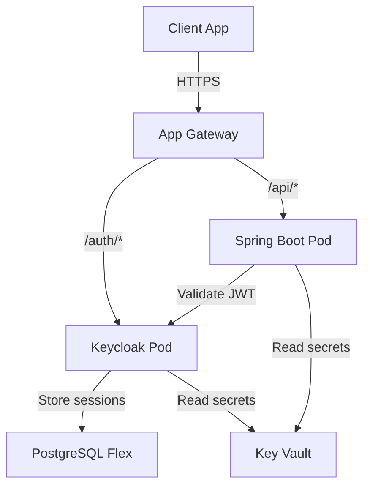

## Architecture



## What I Built

This lab runs Keycloak as a full identity provider on AKS, backed by Azure Database for PostgreSQL Flexible Server. A Spring Boot API acts as an OAuth2 resource server, validating JWTs issued by Keycloak. Azure App Gateway handles ingress with TLS termination.

### Step 1: Keycloak Deployment with Helm

Keycloak runs as a StatefulSet via the Bitnami Helm chart, configured to use an external PostgreSQL database.

```yaml
# values-keycloak.yaml
auth:
  adminUser: admin
  existingSecret: keycloak-admin-secret

postgresql:
  enabled: false

externalDatabase:
  host: pgflex-keycloak.postgres.database.azure.com
  port: 5432
  user: keycloak_admin
  database: keycloak
  existingSecret: keycloak-db-secret
  existingSecretPasswordKey: password

proxyHeaders: xforwarded
httpRelativePath: /auth/

resources:
  requests:
    cpu: 250m
    memory: 512Mi
  limits:
    cpu: 500m
    memory: 1Gi
```

### Step 2: Spring Boot Resource Server

The Spring Boot API validates tokens using Keycloak's JWKS endpoint. No Keycloak adapter needed — standard Spring Security OAuth2 resource server configuration.

```java
@Configuration
@EnableWebSecurity
public class SecurityConfig {

    @Bean
    public SecurityFilterChain filterChain(HttpSecurity http) throws Exception {
        http
            .authorizeHttpRequests(auth -> auth
                .requestMatchers("/api/public/**").permitAll()
                .requestMatchers("/api/admin/**").hasRole("admin")
                .anyRequest().authenticated()
            )
            .oauth2ResourceServer(oauth2 -> oauth2
                .jwt(jwt -> jwt
                    .jwtAuthenticationConverter(jwtAuthConverter())
                )
            );
        return http.build();
    }

    private JwtAuthenticationConverter jwtAuthConverter() {
        JwtGrantedAuthoritiesConverter converter =
            new JwtGrantedAuthoritiesConverter();
        converter.setAuthorityPrefix("ROLE_");
        converter.setAuthoritiesClaimName("realm_access.roles");

        JwtAuthenticationConverter authConverter =
            new JwtAuthenticationConverter();
        authConverter.setJwtGrantedAuthoritiesConverter(converter);
        return authConverter;
    }
}
```

### Step 3: Terraform for PostgreSQL and Networking

```hcl
resource "azurerm_postgresql_flexible_server" "keycloak" {
  name                   = "pgflex-keycloak-${var.environment}"
  resource_group_name    = azurerm_resource_group.main.name
  location               = azurerm_resource_group.main.location
  version                = "15"
  administrator_login    = "keycloak_admin"
  administrator_password = var.pg_admin_password
  zone                   = "1"
  storage_mb             = 32768

  sku_name = "B_Standard_B1ms"

  authentication {
    active_directory_auth_enabled = true
    password_auth_enabled         = true
  }
}
```

## Key Decisions and Trade-offs

- **External PostgreSQL over embedded H2**: Production-realistic. Flexible Server supports Entra ID auth for future migration.
- **Keycloak over Entra ID B2C**: Full control over realm configuration, custom flows, and multi-tenancy. More operational overhead.
- **App Gateway over NGINX Ingress**: Azure-native L7 load balancer with WAF capability. Higher cost but simpler cert management.
- **Standard Spring Security over Keycloak adapter**: The Keycloak adapter is deprecated. Pure OAuth2 resource server config is portable.

## Security Considerations

- Database credentials stored in Key Vault, injected via Kubernetes secrets with CSI driver.
- Keycloak admin password rotated via Key Vault secret versioning.
- Network segmentation: PostgreSQL accessible only from AKS subnet via private endpoint.
- App Gateway WAF rules enabled for OWASP top 10.
- JWT validation against Keycloak JWKS endpoint — no shared secrets.

## Cost Notes

Estimated monthly cost: **~€25/month**. PostgreSQL Flexible Server B1ms (~€12), AKS nodes shared with other labs, App Gateway Basic (~€8). Keycloak and Spring Boot run on the existing AKS node pool.

## How to Reproduce

```bash
# Clone and setup
git clone https://github.com/Tusartus/keycloak-spring-boot-aks.git
cd keycloak-spring-boot-aks

# Deploy infrastructure
cd infra && terraform init && terraform apply

# Deploy Keycloak
helm install keycloak bitnami/keycloak -f values-keycloak.yaml

# Build and deploy Spring Boot app
./mvnw package
az acr build --registry $ACR --image api:latest .
kubectl apply -f k8s/

# Test the flow
curl -X POST $KEYCLOAK_URL/realms/lab/protocol/openid-connect/token \
  -d "grant_type=client_credentials" \
  -d "client_id=api-client" \
  -d "client_secret=$CLIENT_SECRET"
```

## Lessons Learned

1. **Keycloak's resource requirements are real** — it needs at least 512Mi memory to start reliably.
2. **Proxy headers matter** — without correct `X-Forwarded-*` headers, Keycloak generates wrong redirect URIs.
3. **Spring Security's OAuth2 resource server is cleaner than the Keycloak adapter** — and it's the officially recommended path.
4. **PostgreSQL Flexible Server VNET integration simplifies networking** — no need for private endpoints when using delegated subnets.
